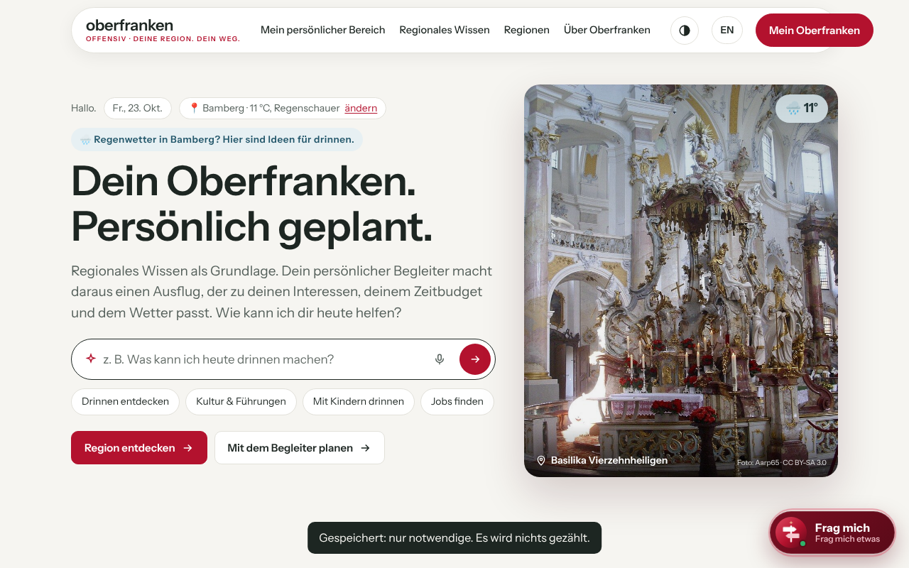
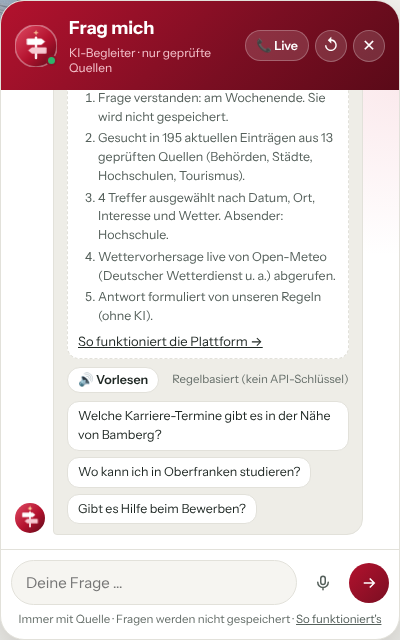
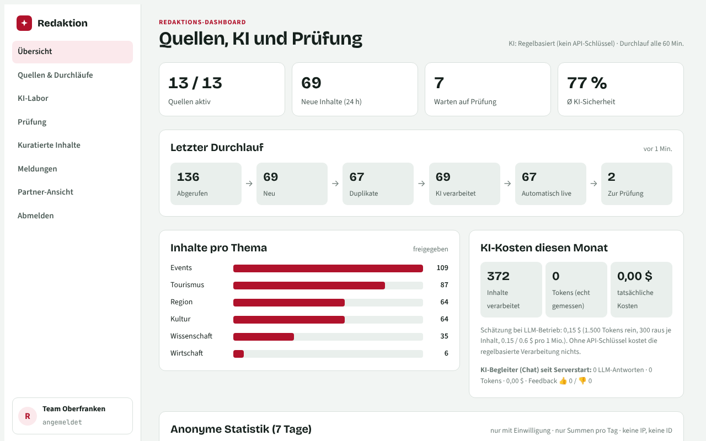
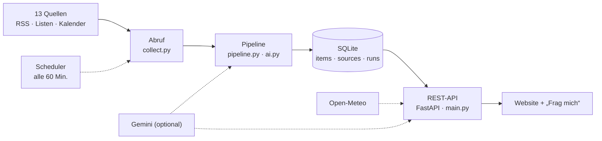
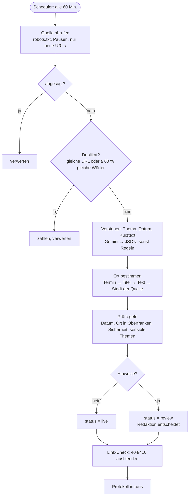

# Plattform Oberfranken – Prototyp

Eine Plattform für Menschen, die neu nach Oberfranken kommen: Termine, Behörden-Infos und Freizeittipps an einem Ort, **immer aktuell und immer mit Quelle**. Dazu ein Assistent („Frag mich“), der nur aus geprüften Einträgen antwortet.

Studienprojekt im Modul *Projekt- und Trendmanagement* (Prof. Dr. Johannes Stübinger, Hochschule Coburg, Standort Kronach) in Zusammenarbeit mit BERGWERK Strategie und Marke GmbH, WS 2026/27.
Mein Schwerpunkt: **Backend** – Datenquellen, Pipeline, Datenbank, API und Datenschutz.

> Studentischer Prototyp, kein offizielles Angebot. Kein offizielles Logo, alle Fotos mit freien Lizenzen (siehe Seite „Bildnachweis“).

*English: A working prototype that collects events and news from 13 official sources in Upper Franconia every hour, cleans and checks them, and serves them through a FastAPI backend to a web app with a source-grounded assistant. Built with Python, FastAPI and SQLite.*

---

## Screenshots

| Startseite | „Frag mich“ mit Hintergrund-Schritten | Redaktion |
|---|---|---|
|  |  |  |

## Was der Prototyp kann

- **13 echte Quellen** (Regierung, Bezirk, Städte, Landkreise, Hochschulen, Tourismus) – RSS-Feeds, Listenseiten und Veranstaltungskalender, stündlich abgerufen
- **Pipeline mit Qualitätsprüfung:** Absagen und Duplikate raus, Thema/Datum/Ort erkennen, Prüfregeln, sensible Themen an die Redaktion, tote Links ausblenden
- **214 Orte** aus der amtlichen Gemeindeliste (Destatis) mit eigenem Wetter (Open-Meteo)
- **„Frag mich“:** sucht nur in geprüften Einträgen; die KI (optional Gemini) bekommt nur diese Treffer – keine erfundenen Termine. Jede Antwort zeigt ihre Schritte unter „Was passiert im Hintergrund?“
- **Läuft auch ohne KI-Schlüssel** mit festen Regeln
- **Datenschutz im Code:** keine IP-Speicherung, Rate-Limit nur über einen täglich wechselnden Hash im Arbeitsspeicher, automatische Löschfristen, Live-Check unter `/api/privacy/check`
- **Barrierefreiheit:** geprüft nach WCAG 2.2 AA (axe), Tastaturbedienung, Bewegung reduzierbar, Deutsch/Englisch

## Architektur



## Ablauf eines Durchlaufs



## Technik

Python 3.10+ · FastAPI · Uvicorn · SQLite · feedparser · httpx · BeautifulSoup · Vanilla JavaScript (SPA) · Open-Meteo · optional Google Gemini

```
app/
  main.py        API, Scheduler, Ranking, Datenschutz-Endpunkte
  collect.py     Abruf: RSS, JSON-LD, Listenseiten, Kalender
  pipeline.py    Duplikate, Absagen, Prüfregeln, Link-Check
  ai.py          KI-Anbindung + Regel-Rückfall, Ortserkennung
  agent.py       „Frag mich“: Suche, Wetter, Antwort
  privacy.py     Rate-Limit ohne IP-Speicherung, Löschfristen
  sources.json   die 13 Quellen
static/          Website (index.html, app.js, i18n.js, site.css) und Redaktion (/admin)
```

## Starten

```bash
pip install -r requirements.txt
cp .env.example .env      # optional: GEMINI_API_KEY eintragen
python run.py
```

- Website: http://localhost:8000
- Redaktion: http://localhost:8000/admin (Zugang aus `.env`)

Windows: Doppelklick auf `start.bat`. Beim ersten Start werden alle Quellen abgerufen (einige Minuten), danach jede Stunde automatisch. Ausführliche Anleitung: [docs/ANLEITUNG_ausfuehrlich.md](docs/ANLEITUNG_ausfuehrlich.md)

## Was ich gelernt habe

Echte Daten sind schwieriger als der Code: Erst mit echten Quellen tauchten falsche Orte, tote Links und abgesagte Termine auf. Daraus entstanden die feste Orts-Reihenfolge, der Link-Check und die Prüfregeln.

## Hinweise

- Entwickelt mit KI-Unterstützung beim Programmieren (Claude). Anforderungen, Entscheidungen, Tests mit echten Daten und Fehlersuche lagen bei uns.
- `.env` (API-Schlüssel, Passwörter) und `data.db` gehören nicht ins Repository.
